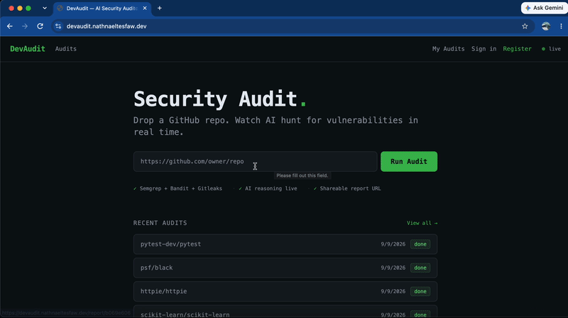

# DevAudit

[](https://github.com/Nathnael45/DevAudit/actions/workflows/ci.yml)

**Autonomous AI security auditing agent for GitHub repositories.**

Drop a GitHub URL and watch the AI clone the repo, run static analysis, and reason through vulnerabilities in real time — streaming every thought to your browser as it works.

🔗 **Live demo:** [https://devaudit.nathnaeltesfaw.dev](https://devaudit.nathnaeltesfaw.dev)



### Sample reports

| Repository | Report | Notes |
|------------|--------|-------|
| [mitmproxy/mitmproxy](https://github.com/mitmproxy/mitmproxy) | [View report](https://devaudit.nathnaeltesfaw.dev/report/e8e09d38) | 4,930 raw scanner alerts; the 80 most severe went to AI review → 17 confirmed findings, incl. a high-severity GitHub Actions shell-injection issue |
| [sherlock-project/sherlock](https://github.com/sherlock-project/sherlock) | [View report](https://devaudit.nathnaeltesfaw.dev/report/a97bb3b3) | 56 raw scanner alerts; 49 went to AI review → 8 confirmed findings, incl. a high-severity GitHub Actions shell-injection issue |
| [OWASP/WebGoat](https://github.com/WebGoat/WebGoat) | [View report](https://devaudit.nathnaeltesfaw.dev/report/15fbe00b) | 231 raw scanner alerts (213 from Semgrep); 48 went to AI review → 11 confirmed findings |

---

## What it does

1. **Clones** the target repo (shallow clone, latest commit only)
2. **Scans** with three static analysis tools in parallel:
   - [Semgrep](https://semgrep.dev) — language-agnostic vulnerability patterns (SQL injection, XSS, insecure APIs)
   - [Bandit](https://bandit.readthedocs.io) — Python-specific security linter
   - [Gitleaks](https://gitleaks.io) — secrets and credential scanner
3. **Reasons** with Claude (claude-sonnet-5 with adaptive thinking) — evaluates each finding, filters false positives, assigns severity, writes fix recommendations
4. **Streams** every token of AI reasoning live to the browser over WebSocket
5. **Generates** a shareable public report URL with full findings grouped by severity

---

## Architecture

```
Browser
  │
  ├── Next.js (port 3000)
  │     └── WebSocket client → live thought log + findings panel
  │
  └── Express API (port 3001)
        ├── POST /api/audits     → enqueue job
        ├── GET  /api/audits/:id → poll status + events
        ├── GET  /api/reports/:slug → shareable report
        └── WebSocket /ws        → push events to browser
              ↑
        BullMQ + Redis (job queue)
              ↓
        Worker Process
              ├── git clone
              ├── Semgrep + Bandit + Gitleaks (parallel)
              ├── Claude API (streaming)
              └── PostgreSQL (persist events + findings)
```

---

## Key design decisions

**Observable agent loop** — the core differentiator. Rather than returning a finished report, every step of the AI's reasoning streams live to the browser. Users watch the agent think ("Semgrep found 3 issues → analyzing for false positives → confirmed SQL injection at line 47").

**HTTP broadcast over persistent WebSocket** — the worker pushes events to the API via HTTP POST (`/internal/broadcast`) rather than maintaining a persistent WebSocket connection, which proved unreliable across Docker networks. The API then fans out to browser clients.

**Bounded AI review** — noisy repos produce thousands of raw alerts (mitmproxy: 4,862 from Bandit alone), so only a bounded slice goes to Claude: up to 30 Semgrep, 30 Bandit and 50 Gitleaks alerts per audit. This keeps the prompt focused and the cost per audit predictable. Semgrep and Bandit alerts are sorted by the scanner's own severity before the cutoff, so their slice is the most serious alerts rather than whatever came first in file order. Gitleaks reports no severity, so its cap is set higher: secrets are rare but high-impact, and each line is short. The live log says when an audit was truncated and how ("reviewing the 30 highest-severity" vs. "reviewing the first 50"). The trade-off: alerts below the cutoff are never reviewed, and many slots can go to repeats of one noisy rule.

**Batched streaming** — Claude token deltas are buffered (300ms or 200 chars) before broadcasting to avoid flooding the HTTP broadcast endpoint with hundreds of tiny requests per second.

**Shallow clone** — `git clone --depth 1` keeps clone times under 10 seconds for most repos and avoids storing full git history on disk.

**Ownership without accounts** — most audits are started anonymously, but people still need to cancel or delete the ones they kicked off. Each audit gets a random owner token at creation time (returned once, held client-side); cancel/delete require that token or a matching authenticated `user_id`. `GET /api/audits/recent` and shareable reports stay public, but only the creator can mutate their own audit.

**Shared secret on the internal broadcast route** — the worker pushes events to the browser via `POST /internal/broadcast` on the API, but the API's port is reachable from outside the docker network too (the browser talks to it directly). That route requires an `INTERNAL_SECRET` header rather than trusting network placement alone.

**Per-phase timing, not just config constants** — each audit records clone/scan/AI durations (`audits.timings`), with each of the three scanners timed individually even though they run concurrently. That's what makes it possible to state an honest parallelism payoff (parallel wall-clock vs. the sum of the three durations run serially) instead of just describing the setting (`concurrency: 3`) and assuming it helped.

**Flat subdomains, not nested ones** — the API is served from `devaudit-api.nathnaeltesfaw.dev` rather than the more obvious `api.devaudit.nathnaeltesfaw.dev`. Cloudflare's free Universal SSL certificate only covers the bare domain plus one level of wildcard (`*.nathnaeltesfaw.dev`); a second nested level has no matching certificate at the edge and fails the TLS handshake before the request ever reaches the tunnel. Keeping both hostnames one level deep avoids paying for Advanced Certificate Manager just for a demo.

---

## Testing

161 automated tests (Vitest) across all three packages — 49 for the API (integration-tested against a real Postgres via `supertest`, not a mocked database), 52 for the frontend, 60 for the worker. GitHub Actions runs lint, typecheck, and the full suite — with a live Postgres service container — on every push.

This isn't just a coverage number: the test suite has caught a real bug (a function that could silently return `undefined` instead of `false`), and every performance claim in this README is backed by a real query against production data rather than an estimate — see [Key design decisions](#key-design-decisions) above.

---

## Known limitations

- **Static analysis is capped at 300 seconds.** Most repos finish well within that, but the largest monorepo-scale codebases (validated against real frameworks like Django, Rails, Angular, and Spring Boot) can hit that ceiling before Semgrep finishes, resulting in a partial rather than exhaustive scan. This is a known, currently-open constraint — not a silent failure. Raising the limit further trades off against tying up a worker slot longer on a resource-constrained host.
- **The AI judges scanner output, not source code.** Claude sees each alert's rule, message, file path, line and scanner confidence — not the code itself — so it can rule out obvious noise (tests, vendored code, duplicates, deliberate training vulnerabilities) but can't confirm a flaw is actually reachable. Its review is also non-deterministic: re-running the same repo can confirm a different number of findings.
- **Low-traffic demo, not a system validated at scale.** Timing and completion-rate numbers in this README come from deliberate test batches run against the live deployment, not from independent production traffic. They're real, reproducible measurements — just not evidence of behavior under concurrent real-world load.

---

## Tech stack

| Layer | Tech |
|-------|------|
| Frontend | Next.js 14, Tailwind CSS, WebSocket |
| API | Express, BullMQ, WebSocket (ws) |
| Agent worker | Node.js, Anthropic SDK (claude-sonnet-5) |
| Static analysis | Semgrep, Bandit, Gitleaks |
| Queue | BullMQ + Redis |
| Database | PostgreSQL |
| Deployment | Docker Compose, AWS EC2, Cloudflare Tunnel (HTTPS, no exposed ports) |

---

## Running locally

**Prerequisites:** Docker + Docker Compose

```bash
git clone https://github.com/Nathnael45/DevAudit.git
cd DevAudit
cp .env.example .env
# Fill in ANTHROPIC_API_KEY, JWT_SECRET, INTERNAL_SECRET, and POSTGRES_PASSWORD in .env
docker-compose up --build
```

Open [http://localhost:3000](http://localhost:3000).

**Generate a secret** (for `JWT_SECRET` and `INTERNAL_SECRET`):
```bash
openssl rand -base64 32
```

Postgres and Redis are not published to the host — only `api`/`worker` need to reach
them, over the docker network. If you run `api`/`worker`/`web` natively via the root
`npm run dev` script instead of the full compose stack, add a git-ignored
`docker-compose.override.yml` that republishes `5432`/`6379` for your machine.

Upgrading an existing deployment, or curious about the Cloudflare Tunnel setup? See [DEPLOYMENT.md](DEPLOYMENT.md).

---

<details>
<summary><strong>Environment variables</strong></summary>

| Variable | Description |
|----------|-------------|
| `ANTHROPIC_API_KEY` | Anthropic API key |
| `JWT_SECRET` | Random secret for JWT signing |
| `INTERNAL_SECRET` | Random secret shared by api/worker, required on `POST /internal/broadcast` |
| `POSTGRES_PASSWORD` | Postgres password (also used to build `DATABASE_URL`) |
| `DATABASE_URL` | PostgreSQL connection string |
| `REDIS_URL` | Redis connection string |
| `NEXT_PUBLIC_API_URL` | API base URL (browser-facing) |
| `NEXT_PUBLIC_WS_URL` | WebSocket base URL (browser-facing) |
| `INTERNAL_API_URL` | API base URL (server-side, uses Docker hostname) |
| `WEB_URL` | The only origin the API's CORS policy allows — must match wherever `web` is actually served |
| `TRUST_PROXY` | Proxy hops in front of the API (`1` behind Cloudflare Tunnel, `0` otherwise) — without it the rate limit is shared by every visitor |
| `DAILY_AUDIT_CAP` | Site-wide max audits per rolling 24h (default 50) — caps Claude API spend |
| `MAX_REPO_SIZE_MB` | Repos larger than this (GitHub-reported size) are refused before cloning (default 1024) |

</details>
